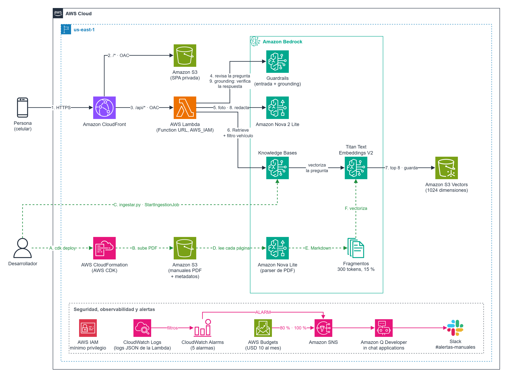
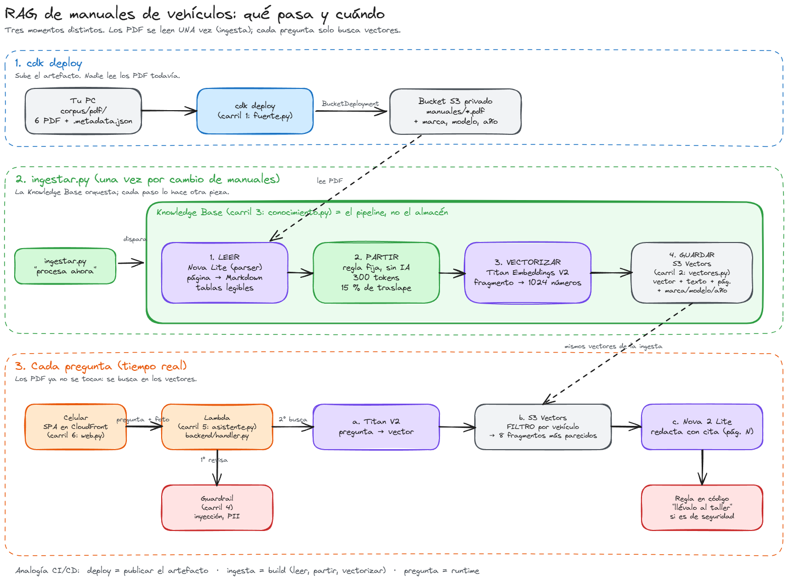

# Manual de mi vehículo

**Asistente que responde con lo que dice el manual de TU moto o carro, citando la página.**
Preguntas "¿cada cuánto cambio el aceite?" o subes una foto del tablero ("¿qué significa esta luz?") y responde con el manual de ese vehículo. Si el tema es de seguridad, te dice que lo lleves al taller.




> Línea sólida: cada pregunta. Línea punteada: ingesta de manuales. Rosado: alertas.
> Diagrama editable: [`docs/arquitectura.drawio`](docs/arquitectura.drawio) (draw.io). El flujo paso a paso está en [Cómo funciona](#cómo-funciona).

---

## Contenido

1. [Qué problema resuelve](#qué-problema-resuelve)
2. [Cómo funciona](#cómo-funciona)
3. [Decisiones de arquitectura](#decisiones-de-arquitectura)
4. [Controles de seguridad y gobierno](#controles-de-seguridad-y-gobierno)
5. [Lecciones aprendidas](#lecciones-aprendidas)
6. [Estructura del repositorio](#estructura-del-repositorio)
7. [Desplegar](#desplegar)
8. [Costos](#costos)
9. [Destruir](#destruir)
10. [Manuales y derechos de autor](#manuales-y-derechos-de-autor)

---

## Qué problema resuelve

Los manuales del propietario tienen cientos de páginas y nadie los lee. La información está, pero no se encuentra cuando hace falta.

El riesgo principal no es que el asistente no sepa: es que **responda con el manual equivocado** (el intervalo de aceite de otra moto) o que **invente una cita**. Todo el diseño gira alrededor de evitar esas dos cosas.

**Escalón de autonomía: 2 (RAG).** No hace falta un agente: no hay acciones ni un camino que dependa del caso. Se descartó un agente con herramientas porque suma latencia y riesgo sin aportar valor aquí.

**Corpus:** 6 manuales oficiales, 4 motos y 2 carros, en español e inglés.

| Vehículo | Tipo | Idioma |
| --- | --- | --- |
| Honda Wave 110i (2015) | Moto | Español |
| Yamaha XTZ125 | Moto | Español |
| Yamaha XTZ250 | Moto | Español |
| Bajaj Pulsar NS125 | Moto | Inglés |
| Nissan Frontier (2023) | Camioneta | Español |
| BYD Seagull (eléctrico) | Carro | Inglés |

Los manuales en inglés se responden en español, manteniendo la cita de página.

---

## Cómo funciona

Hay tres momentos distintos. Los PDF se leen **una sola vez**, en la ingesta; cada pregunta solo busca en los vectores.



### Cada pregunta (tiempo real)

| Paso | Qué pasa | Servicio |
| --- | --- | --- |
| 1 | La persona abre la web desde el celular por HTTPS | Amazon CloudFront |
| 2 | CloudFront sirve la SPA desde un bucket privado (`/*`, Origin Access Control) | Amazon S3 |
| 3 | La SPA envía pregunta, vehículo y foto a `/api/*`. CloudFront firma la petición hacia la Lambda (OAC) | AWS Lambda (Function URL con `AWS_IAM`) |
| 4 | El guardrail revisa la entrada: prompt injection, insultos y datos personales | Bedrock Guardrails |
| 5 | Si hay foto, Nova describe el testigo del tablero; esa descripción se suma a la búsqueda | Amazon Nova 2 Lite |
| 6 | La Knowledge Base busca **solo en el manual del vehículo elegido** (filtro por marca, modelo y año) | Bedrock Knowledge Bases |
| 7 | Titan vectoriza la pregunta y S3 Vectors devuelve los 8 fragmentos más parecidos | Titan Embeddings V2, S3 Vectors |
| 8 | Nova redacta la respuesta con la página citada | Amazon Nova 2 Lite |
| 9 | El guardrail compara la respuesta con los fragmentos (grounding contextual). Si afirma algo que no está, no se entrega y se muestran las páginas para revisar. Si la pregunta describe un síntoma de seguridad, el código agrega "llévalo al taller" | Bedrock Guardrails |

El código de estos pasos está en [`backend/handler.py`](backend/handler.py), comentado paso por paso.

### Ingesta (una vez por cambio de manuales)

| Paso | Qué pasa | Quién lo hace |
| --- | --- | --- |
| A | `cdk deploy` sube los PDF y sus metadatos (`.metadata.json`) a S3 | AWS CDK |
| B | `ingestar.py` le dice a la Knowledge Base "procesa ahora" | Script |
| C | **Leer:** cada página se lee como imagen y se transcribe a Markdown, con las tablas legibles | Amazon Nova Lite (parser) |
| D | **Partir:** el texto se corta en fragmentos de 300 tokens con 15 % de traslape. Es una regla fija, sin IA | Knowledge Base |
| E | **Vectorizar:** cada fragmento se convierte en un vector de 1024 números | Titan Embeddings V2 |
| F | **Guardar:** el vector se guarda con su texto, su página y los metadatos del vehículo | S3 Vectors |

> La Knowledge Base **no es un almacén**: es el pipeline que orquesta. Nova y Titan son los trabajadores; S3 Vectors es el almacén.
> Analogía de CI/CD: `cdk deploy` publica el artefacto, la ingesta es el build y cada pregunta es el runtime.

Toda la receta de la ingesta (de dónde leer, cómo parsear, cómo partir, con qué modelo vectorizar) es **configuración versionada** en [`infra/infra_manuales/conocimiento.py`](infra/infra_manuales/conocimiento.py), no un script suelto.

### Alertas

Cinco alarmas de CloudWatch y un presupuesto de AWS Budgets publican en un tema de SNS. **Amazon Q Developer in chat applications** (antes AWS Chatbot) lo entrega en un canal de Slack. Sin webhook y sin secreto que guardar.

| Alerta | Señal | Umbral | Qué hacer si suena |
| --- | --- | --- | --- |
| Errores | Errores de la Lambda | 1 o más en 5 min | Revisar en los logs qué paso falló |
| Lentitud | Duración p90 | Más de 20 s en 15 min | Ver si es Bedrock o la búsqueda |
| Abuso | Invocaciones | Más de 200 por hora | Poner AWS WAF con límite de tasa en CloudFront |
| **Ataques** | Bloqueos del guardrail (filtro sobre los logs) | 5 o más en 15 min | Revisar el origen: es evidencia de que el control funciona |
| **Calidad** | % de respuestas "no encontré" (filtro sobre los logs) | Más de 40 % en 1 h | Correr el set dorado: posible regresión del parsing |
| Costo | AWS Budgets | 80 % real o 100 % pronosticado de USD 10 al mes | Destruir la pila o investigar el gasto |

Las alertas de **ataques** y **calidad** son las propias de un sistema de IA: un RAG puede estar 100 % disponible y responder mal.

---

## Decisiones de arquitectura

Criterios, en orden de peso: (1) no responder con el manual equivocado, (2) respuesta trazable con cita, (3) usable desde el celular por alguien no técnico y (4) costo cercano a cero y destruible.

| Decisión | Elegido | Descartado | Por qué |
| --- | --- | --- | --- |
| RAG | Bedrock Knowledge Bases | Pipeline propio (LangChain) | Menos código y operación; el pipeline queda como configuración |
| Vector store | **S3 Vectors** | OpenSearch Serverless | OpenSearch Serverless cobra un mínimo mensual aunque no se use `[verificar]`; S3 Vectors cobra por uso |
| Parser | **Nova Lite (modelo con visión)** | Parser por defecto (solo texto) | El parser por defecto pierde las columnas de las tablas de mantenimiento. Costo: tokens por página, solo al ingerir |
| Generador | **Nova 2 Lite** | Claude | Lee imágenes, es barato y lo cubren los créditos de AWS. Se escala a Nova Pro solo si las pruebas muestran que lee mal las fotos |
| Filtro por vehículo | Metadatos en cada fragmento, filtro antes de buscar | Un índice por vehículo | Un solo índice escala; el filtro garantiza que nunca entra otro manual |
| Entrada | **CloudFront delante de todo** | Function URL pública | Un solo dominio, sin CORS, la Lambda no es alcanzable sin pasar por el borde, y ahí se pone WAF |
| Alertas | Slack con Amazon Q Developer | Webhook + Lambda + Parameter Store | Igual de gratis, sin código ni secreto que cuidar |
| Infraestructura | AWS CDK en Python, un archivo por carril | Una sola pila monolítica | Cada carril se lee y se explica por separado |

---

## Controles de seguridad y gobierno

Todos los controles viven **fuera del modelo**: se cumplen aunque el modelo se equivoque o lo manipulen.

| Control | Dónde vive | Qué evita |
| --- | --- | --- |
| Filtro por vehículo antes de buscar | `handler.py`, `buscar()` | Responder con el manual de otro vehículo |
| Sin vehículo identificado, se pregunta | `handler.py`, paso 1 | Adivinar el vehículo |
| Guardrail en entrada y salida, con versión fija | `guardrail.py` | Prompt injection, insultos, datos personales en claro |
| Grounding contextual sobre cada respuesta | `guardrail.py`, `handler.py` paso 6 | Respuestas con una cita real pero con un dato que no está en el fragmento |
| Sin fragmentos, no se llama al modelo | `handler.py`, paso 5 | Respuestas sin fuente |
| "No encontré" se responde solo, sin relleno | `handler.py` | Que el modelo complete con conocimiento propio |
| Regla de seguridad en código, por síntomas (luces rojas, frenos, temperatura, fugas, ruidos) | `handler.py`, `TEMAS_SEGURIDAD` | Que "llévalo al taller" dependa del modelo, o que salga en cualquier pregunta y deje de servir |
| IAM de mínimo privilegio por carril | Cada archivo de `infra_manuales/` | Que una pieza pueda hacer más de lo que necesita |
| Buckets privados, SSE-S3, solo HTTPS | `fuente.py`, `web.py` | Acceso directo a los datos |
| Lambda solo invocable por CloudFront (OAC, `AWS_IAM`) | `web.py` | Saltarse el borde |
| Logs JSON por paso, una semana de retención | `handler.py`, `asistente.py` | No saber qué paso falló ni por qué |

---

## Lecciones aprendidas

### 1. El parsing es la decisión más subestimada de un RAG

La primera versión usaba el parser por defecto, que solo extrae texto. En el cuadro de mantenimiento de la Yamaha XTZ125, la fila *Aceite de motor* marca los kilómetros con chulos en columnas. El parser entregaba `Aceite de motor / Cambiar / √√√√√√`: las columnas se perdían y **ningún chunking ni embedding podía recuperarlas**. El asistente respondía, con razón, que no lo encontraba.

**Solución:** un modelo con visión como parser, que lee la página como imagen.

### 2. Las alucinaciones también pasan al ingerir

El primer prompt del parser traía un ejemplo concreto ("Aceite de motor: cambiar a los 500 km, 3000 km..."). En la página del **índice alfabético**, Nova Lite copió el ejemplo y **inventó una tabla de aceite** que no existe. Ese fragmento falso era el primer resultado para "¿cada cuánto cambio el aceite?": el asistente habría citado "(pág. 89)" con total seguridad, y esa página es el índice.

Se detectó **contrastando la cita con el PDF fuente**. Solución: un prompt sin ejemplos de contenido, que prohíbe inventar, y una reingesta completa con una fuente de datos nueva (la anterior se borra con sus vectores).

**Consecuencia para las pruebas:** el set dorado valida la **página citada**, no solo que la respuesta suene bien.

### 3. Grounding no es lo mismo que completitud

Con el parser corregido se agregó un **grounding contextual** en el guardrail: cada respuesta se compara con los fragmentos y, si afirma algo que no está, no se entrega. Los puntajes reales:

| Pregunta | Grounding | Resultado |
| --- | --- | --- |
| Luz roja de presión de aceite (Nissan Frontier) | 0,99 | Se entrega |
| Cantidad de aceite (Yamaha XTZ125) | 0,87 | Se entrega: 1.00 L, pág. 50 |
| Cada cuánto cambio el aceite (Yamaha XTZ125) | 0,92 | Se entrega: "cada 3000 km (pág. 44)" |
| Trampa: pregunta de moto con la camioneta elegida | **0,49** | **Bloqueada**: se muestran las páginas para revisar |

El caso del aceite muestra el límite del control: el cuadro de mantenimiento marca cambio a los **500**, 3000, 6000, 9000, 12000 y 15000 km. "Cada 3000 km" **está respaldado**, pero **omite el primer cambio a los 500 km**. El grounding mide que lo dicho esté en la fuente, no que esté completo.

**Consecuencia:** el set dorado valida los datos esperados de cada respuesta (por ejemplo, "500 km" y "3000 km"), no solo que haya una cita.

### 4. Un aviso que sale siempre deja de servir

La regla de "llévalo al taller" saltaba con la palabra *aceite*, incluso en "¿cuánta cantidad lleva?". Ahora se activa por **síntomas** en la pregunta o en la foto (luces rojas, frenos, temperatura, fugas, ruidos), no por la respuesta del modelo.

### 5. El backend no debe ser alcanzable sin pasar por el borde

La primera versión exponía la Function URL de la Lambda como pública. Ahora CloudFront es la única puerta: la Lambda exige firma (`AWS_IAM`) y solo CloudFront firma (OAC). Para los `POST`, el navegador envía el SHA-256 del cuerpo en el header `x-amz-content-sha256`, como exige Lambda.

---

## Estructura del repositorio

```
.
├── backend/handler.py            Lambda: los 5 pasos de cada pregunta, comentados
├── web/index.html                SPA para el celular (vehículo, pregunta, foto)
├── corpus/manuales.json          Catálogo: vehículo, metadatos y URL oficial del PDF
├── scripts/
│   ├── descargar_manuales.py     Descarga los PDF y escribe sus metadatos
│   └── ingestar.py               Lanza la ingesta y espera a que termine
├── infra/                        AWS CDK en Python (uv)
│   ├── app.py
│   └── infra_manuales/
│       ├── stack.py              Índice: conecta los siete carriles
│       ├── fuente.py             1. S3 con los PDF
│       ├── vectores.py           2. S3 Vectors
│       ├── conocimiento.py       3. Knowledge Base: parser, chunking, embeddings
│       ├── guardrail.py          4. Bedrock Guardrails
│       ├── asistente.py          5. Lambda y sus permisos
│       ├── web.py                6. CloudFront, SPA y Function URL con OAC
│       └── alertas.py            7. Alarmas, presupuesto y Slack
└── docs/
    ├── 00-inception.md           Inception (AI-DLC): intención, criterios, supuestos
    ├── arquitectura.drawio       Diagrama editable
    ├── arquitectura.png          Diagrama para este README
    ├── flujo-rag.excalidraw      Flujo a mano alzada: deploy, ingesta, pregunta (editable)
    └── flujo-rag.png             El mismo flujo, para este README
```

---

## Desplegar

### Requisitos

- Cuenta de AWS con sesión en la CLI (`aws login` o un perfil) y acceso a Amazon Nova y Titan en Bedrock.
- [uv](https://docs.astral.sh/uv/) y Node.js (para `npx cdk`).
- Región: **us-east-1** (S3 Vectors, Nova 2 Lite y la integración con Knowledge Bases disponibles).
- La cuenta con CDK bootstrap (`npx cdk bootstrap` una sola vez).

### Pasos

**1. Descargar los manuales** desde el sitio oficial de cada fabricante:

```bash
uv run --project infra python scripts/descargar_manuales.py
```

**2. (Opcional) Preparar Slack** para las alertas, una sola vez:

1. En Slack, crea el canal `#alertas-manuales` y copia su ID (empieza por `C`), al final de los detalles del canal.
2. En la consola de AWS (us-east-1), abre *Amazon Q Developer in chat applications*, elige *Configure new client* → *Slack* y autoriza tu workspace. Copia el *Workspace ID* (empieza por `T`).
3. Invita la app de AWS al canal con `/invite`.

**3. Desplegar** desde `infra/`:

```bash
cd infra
npx cdk deploy --context region=us-east-1 --context slack_workspace=T... --context slack_canal=C...
```

Sin los IDs de Slack, las alarmas se crean igual pero nadie recibe el aviso. Los IDs no se guardan en el repo.

**4. Ingerir los manuales.** Tarda varios minutos, porque un modelo lee cada página:

```bash
uv run python ../scripts/ingestar.py
```

La ingesta corre en AWS: el script solo consulta el estado y se puede cerrar.

**5. Abrir la web.** La URL sale al final del deploy como `UrlWeb`.

### Apagar la web sin destruir nada

La distribución de CloudFront solo atiende peticiones desde Colombia. Para dejarla deshabilitada (por ejemplo, de noche), sin borrar la Knowledge Base ni lo ingerido:

```bash
npx cdk deploy --context region=us-east-1 --context web_activa=false
```

Para encenderla, el mismo comando sin `web_activa=false`. Cada cambio tarda unos minutos mientras CloudFront se propaga.

### Probar que las alertas llegan a Slack

```bash
aws cloudwatch describe-alarms --region us-east-1 --query "MetricAlarms[].AlarmName"
aws cloudwatch set-alarm-state --region us-east-1 --alarm-name NOMBRE --state-value ALARM --state-reason "Prueba de Slack"
```

---

## Costos

Estimación para una demo con poco tráfico, en us-east-1 `[verificar con la calculadora de AWS]`:

| Concepto | Cuándo se paga | Estimado |
| --- | --- | --- |
| Parsing con Nova Lite (~1.100 páginas) | Una vez por ingesta | ~USD 0,30 |
| Embeddings con Titan | Una vez por ingesta | Centavos |
| S3 Vectors y S3 | Mensual, por almacenamiento | Centavos |
| Cada pregunta (Titan + Nova 2 Lite) | Por uso | Fracciones de centavo |
| CloudFront, Lambda, CloudWatch | Por uso | Dentro del nivel gratuito para una demo |

El presupuesto de AWS Budgets avisa al 80 % de USD 10 al mes. Ojo: el presupuesto cubre **toda la cuenta**, no solo esta demo.

---

## Destruir

```bash
cd infra
npx cdk destroy --context region=us-east-1
```

Todo tiene política `DESTROY`: buckets (se vacían solos), índice de vectores, Knowledge Base, guardrail, Lambda, CloudFront, alarmas, presupuesto y la integración con Slack. La autorización del workspace de Slack en la consola de AWS se borra a mano si ya no se usa.

---

## Manuales y derechos de autor

Los manuales tienen derechos de autor de sus fabricantes. Que se puedan descargar gratis no da permiso para redistribuirlos, por eso **este repositorio no contiene ningún PDF**: [`scripts/descargar_manuales.py`](scripts/descargar_manuales.py) los baja desde la URL oficial que está en [`corpus/manuales.json`](corpus/manuales.json), y `corpus/pdf/` está en `.gitignore`.

| Vehículo | Fuente |
| --- | --- |
| Honda Wave 110i (2015) | Sitio oficial de Honda Motos España |
| Nissan Frontier (2023) | Sitio oficial de Nissan México |
| Yamaha XTZ125 y XTZ250 | Sitio oficial de Incolmotos Yamaha (Colombia) |
| Bajaj Pulsar NS125 | Sitio oficial de Bajaj Auto (distribuida en Colombia por Auteco) |
| BYD Seagull | Sitio oficial de BYD (edición Marruecos; en Colombia se vende como Dolphin Mini `[verificar]`) |

Esta es una demo educativa: no reemplaza el manual ni la revisión de un técnico.
